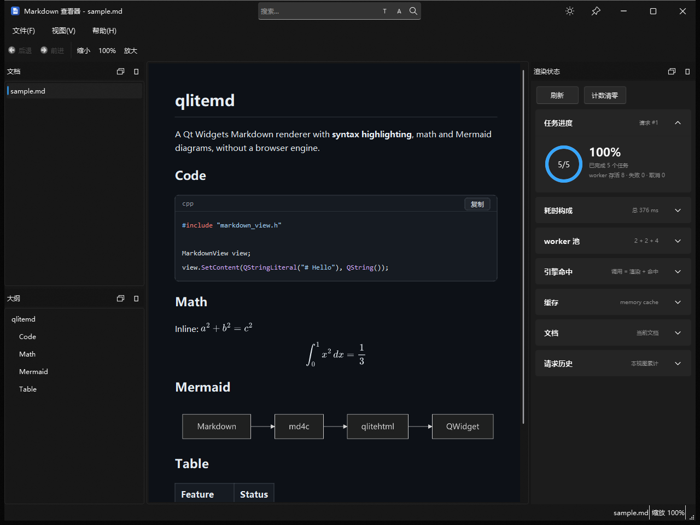

# qlitemd

**一个不需要浏览器内核的 Qt Widgets Markdown 渲染器。**

md4c 负责解析，qlitehtml 负责排版，QuickJS 负责运行 highlight.js、
MathJax 和 Mermaid。公式与图表的 SVG 由 QPainter 光栅化，运行时不需要
WebEngine、Chromium 或 Node.js。

[](https://github.com/qyslamd/qlitemd/actions/workflows/build.yml)
[](LICENSE)
[](#构建要求)
[](#构建要求)

[English](README.md) · [示例程序](examples/md_viewer) · [文档](docs/)



## 为什么做 qlitemd

在 Qt 应用里嵌入 Markdown 预览，通常要在两种取舍之间选：

- **QtWebEngine** 能力完整，但会引入 Chromium、较大的运行时和较慢的
  冷启动。
- **QTextDocument** 足够轻，但 Markdown/CSS 支持有限，公式、Mermaid
  和完整的 HTML/CSS 排版都做不到。

qlitemd 走第三条路：用 qlitehtml 支撑一个原生 `QWidget`，只在需要
产出公式、图表和高亮 SVG 的地方使用 JavaScript。公开头文件不暴露
qlitehtml、QuickJS 或 md4c 的类型，替换渲染后端不需要改调用方。

## 快速开始

```cmake
add_subdirectory(path/to/qlitemd)
target_link_libraries(myapp PRIVATE qlitemd_markdown)
```

或者使用已安装的 SDK：

```cmake
find_package(qlitemd CONFIG REQUIRED)
target_link_libraries(myapp PRIVATE qlitemd::markdown)
```

```cpp
#include "markdown_view.h"

auto* view = new MarkdownView(parent);
view->LoadFile(QStringLiteral("README.md"));
// 或者：view->SetContent(markdown_text, base_directory);
```

独立的 `QWidget` 示例在 [`examples/minimal`](examples/minimal)，不依赖
FluentUI/QWindowKit，可直接针对已安装的 SDK 构建。

## 功能

- **GFM Markdown**：通过 md4c 支持表格、任务列表、删除线和自动链接；
  原始 HTML 原样保留。
- **代码高亮**：highlight.js 在 QuickJS 中运行；示例按行拆分 span，
  保证行号对齐。
- **公式**：MathJax（TeX 转 SVG 再转 QPixmap），支持行内 `$...$` 与
  独立 `$$...$$`，配色跟随主题。
- **Mermaid 图表**：官方 Mermaid bundle 配合轻量 DOM shim 在 QuickJS
  中运行；SVG 清理后按 2 倍分辨率光栅化。
- **主题**：内置明暗两套 CSS；可用 `MD_MARKDOWN_CSS` 覆盖样式表，
  方便实时调整。
- **代码块外框**：语言标签、复制链接和可选行号。
- **大纲**：带稳定 slug 的 `MarkdownHeading` 列表，可直接用于侧栏和
  锚点跳转。
- **查找**：区分大小写、全词匹配、反向查找，并报告是否绕回。
- **缩放**：Ctrl+滚轮或内置动作，0.3 到 5.0 倍，带防抖重排。
- **异步渲染**：按引擎划分 worker 池，用 request id 过滤过期结果，
  切换文档时取消旧任务。
- **三级缓存**：内存 HTML 缓存、以 SHA-256 为键的磁盘缓存、跨文档
  QPixmap 缓存。
- **导出**：HTML 连同 `_files/` 资源目录；PDF 使用宿主传入的
  `QPrinter`。
- **诊断**：`qt.markdown.render` 日志类别、分阶段耗时统计，以及可选的
  产物落盘（`MD_MARKDOWN_DUMP`）。

## 架构

```text
Markdown 源文
      |
      v
md4c  ->  HTML 骨架 + 公式/Mermaid 占位符
      |
      v
MarkdownRenderService（worker 池）
      |-- highlight.js  ->  高亮后的 HTML
      |-- MathJax       ->  SVG  ->  QPainter  ->  PNG
      `-- Mermaid       ->  SVG  ->  QPainter  ->  PNG
      |
      v
拼装 HTML  ->  qlitehtml 控件  ->  绘制出的 QWidget
```

关键设计：

- **依赖倒置**：公开 API 不认识 QuickJS。高亮、公式和 Mermaid 都通过
  普通回调传入，测试可以塞假实现，宿主可以替换引擎。
- **字节码而非源码**：五份 JS 载荷在构建期由 `qjsc` 预编译。含公式和
  图表的首次渲染从约 1.57 s 降到 0.67 s；见
  [评估文档](docs/eval/Markdown渲染qjsc预编译评估.md)。
- **按代过滤**：每次渲染递增 request id，过期的 worker 结果在接触控件
  之前就被丢弃；取消会中断 QuickJS。
- **一次性失败语义**：JS 引擎加载失败后保持失败状态，直到视图重置，
  不会在每次按键时重试。

更多说明：[架构](docs/architecture.md)、[渲染管线](docs/rendering.md)、
[诊断](docs/diagnostics.md)。

## 构建要求

- CMake 3.19 或更高
- Ninja
- 支持 C++17 的编译器
- Qt 5.14 或更高，或 Qt 6.x；需要 Core、Gui、Widgets、Svg、Network、
  PrintSupport 和 Test 模块

已验证配置：

| Qt | 架构 | 状态 |
| --- | --- | --- |
| Qt 5.15.2 | x86 | 库、测试、`md_viewer`、安装 |
| Qt 5.14.2 | x64 | 库、测试、`md_viewer` |
| Qt 6.8.3 | x64 | 库、测试和 `md_viewer` 构建；运行时界面尚未验证 |
| Qt 6.8.3 | x64（Linux） | CI 中构建库并运行测试；`md_viewer` 暂不构建 |
| Qt 5.12.12 | x64 | 不支持；最低要求 Qt 5.14 |

Windows + MSVC 是主平台。Linux 的库与测试已由 CI（Ubuntu 24.04 +
Qt 6.8.3）覆盖；`md_viewer` 尚未在 Linux 上构建。Ubuntu 20.04 自带
Qt 5.12.8，低于最低要求 Qt 5.14，需要安装更新的 Qt 或 Qt 6。

## 构建

Windows 下请在 Visual Studio 开发者命令行中执行。

Linux 下把 `CMAKE_PREFIX_PATH` 指向 Qt 5.14+ 或 Qt 6。CI 的 Linux job
关闭 `md_viewer`，用 Qt 6.8.3 构建库并运行测试。

```bash
cmake -S . -B build -G Ninja \
  -DCMAKE_BUILD_TYPE=RelWithDebInfo \
  -DCMAKE_PREFIX_PATH=/path/to/Qt/5.15.2/msvc2019
cmake --build build
```

Qt 6：

```bash
cmake -S . -B build-qt6 -G Ninja \
  -DCMAKE_BUILD_TYPE=RelWithDebInfo \
  -DQLITEMD_QT_MAJOR=6 \
  -DCMAKE_PREFIX_PATH=/path/to/Qt/6.8.3/msvc2022_64
cmake --build build-qt6
```

构建开关：

- `QLITEMD_QT_MAJOR`：`5`（默认）或 `6`
- `QLITEMD_BUILD_MD_VIEWER`：构建示例程序（默认 `ON`）
- `QLITEMD_BUILD_TESTS`：构建测试（默认 `ON`）

## 测试

```bash
ctest --test-dir build --output-on-failure
```

## 安装

```bash
cmake -S . -B build -DCMAKE_INSTALL_PREFIX=<prefix>
cmake --build build
cmake --install build
```

默认选项下，安装内容包含 `bin/md_viewer.exe`、`qlitemd_markdown`
静态库及其静态依赖、公开头文件、许可证文件和 CMake package config。
Windows 安装阶段会调用 `windeployqt`，并拷贝项目内构建的
`FluentUI3Style.dll` 和 `ExWidgets.dll`。

消费方可以这样使用：

```cmake
find_package(qlitemd CONFIG REQUIRED)
target_link_libraries(myapp PRIVATE qlitemd::markdown)
```

只安装库 SDK 时，配置阶段加上 `QLITEMD_BUILD_MD_VIEWER=OFF` 和
`QLITEMD_BUILD_TESTS=OFF`。

安装组件：

- `Runtime`：`md_viewer`、FluentUI/ExWidgets DLL 和部署的 Qt 运行时
- `Development`：静态库、公开头文件和 `qlitemdConfig.cmake`
- `Licenses`：项目和第三方许可证文本

```bash
cmake --install build --component Runtime
cmake --install build --component Development
cmake --install build --component Licenses
```

## 发布

匹配 `v*` 的 tag 会通过 GitHub Actions 构建 Qt 5.15.2 x64 Windows
安装包和 PDB 归档。安装包包含 `md_viewer`、Qt 运行时和许可证文件；
SDK 仍通过独立的 install 组件发布。

## 示例程序

`examples/md_viewer` 是基于本库的完整 FluentUI 风格查看器，包含单实例、
目录侧栏、大纲、查找、缩放、最近文件、图片预览/另存为、公式与 Mermaid
源码查看、HTML/PDF 导出和渲染状态面板。它也是链接策略、设置持久化等
宿主侧策略的参考实现。

## 目录结构

- `src/markdown/`：库主体
- `resources/`：主题 CSS 与 JS 载荷
- `examples/md_viewer/`：FluentUI 示例程序
- `examples/minimal/`：面向已安装 SDK 的独立 QWidget 示例
- `tests/markdown/`：无头 GoogleTest 测试
- `cmake/`：package config 模板与测试辅助
- `installer/`：Windows 安装包的 Inno Setup 脚本
- `licenses/`：JS 载荷的许可证文本
- `3rdparty/`：固定版本、已打补丁的依赖快照
- `patches/`：补丁来源记录
- `docs/`：架构、渲染和诊断文档
- `CHANGELOG.md`：发布说明

## 已知限制

- 不下载远程图片；只支持本地文件和 `data:` URI。
- PDF 导出按页面高度切分布局，超长元素可能被切在页缝上。
- Linux 和 Qt 6 已有库/测试构建覆盖；`md_viewer` 的 Linux 运行时和
  界面验证仍未完成。
- Ubuntu 20.04 自带的 Qt 5.12.8 低于最低要求 Qt 5.14，需要安装更新的 Qt。
- 仓库不重新分发微软 Segoe Fluent Icons 字体；FluentUI 使用系统
  `Segoe Fluent Icons`，缺失时回退到 `Segoe MDL2 Assets`。两者都没有
  的机器会显示占位方框。

## 第三方库

qlitemd 建立在这些开源项目之上，感谢它们的维护者和贡献者。

| 项目 | 版本 | 用途 | 许可证 |
| --- | --- | --- | --- |
| [litehtml](https://github.com/litehtml/litehtml) | 0.10（快照） | HTML/CSS 排版 | BSD-3-Clause |
| [qlitehtml](https://github.com/qtproject/qlitehtml) | 1.0（快照） | Qt 控件桥接 | BSD-3-Clause |
| [md4c](https://github.com/mity/md4c) | 0.5.3 | Markdown 解析 | MIT |
| [QuickJS](https://bellard.org/quickjs/) | 0.17.0 | JavaScript 运行时 | MIT |
| [gumbo-parser](https://github.com/google/gumbo-parser) | 随 litehtml 内置 | HTML5 解析 | Apache-2.0 |
| [highlight.js](https://highlightjs.org/) | 11.12.0 | 语法高亮 | BSD-3-Clause |
| [MathJax](https://www.mathjax.org/) | 3.2.1（mathjax-full） | TeX 转 SVG | Apache-2.0 |
| [Mermaid](https://mermaid.js.org/) | 11.16.0 | 图表渲染 | MIT |
| [mermaidx](https://github.com/MohammadRaziei/mermaidx) | 0.9.5 | 载荷抽取 / DOM shim | MIT |
| [QWindowKit](https://github.com/stdware/qwindowkit) | 1.5.0 | 无边框窗口（`md_viewer`） | Apache-2.0 |
| [qmsetup](https://github.com/stdware/qmsetup) | 1.0.0（4a3ff82） | QWindowKit 的 CMake 辅助 | MIT |
| [FluentUIStyle](https://github.com/XHY-ChuJian/FluentUIStyle) | 4.0 | Fluent UI 外壳（`md_viewer`） | MIT |
| [spdlog](https://github.com/gabime/spdlog) | 1.17.0 | 日志（`md_viewer`） | MIT |
| [GoogleTest](https://github.com/google/googletest) | 1.17.0 | 测试 | BSD-3-Clause |
| [Qt](https://www.qt.io/) | 5.14+ / 6.x | 应用框架（外部依赖） | LGPLv3 / GPLv3 / 商业许可 |

表中的版本是本仓库内置的快照版本，上游可能已有更新。完整许可证文本见
[NOTICE](NOTICE)，安装后也会放在 `licenses/` 下。

## 开发说明

本仓库代码主要由 AI 编程助手生成。维护者提供设计目标、约束与审查，
AI 负责实现和迭代；提交历史不添加 AI 共同作者署名。最终取舍与验证由
维护者负责。

## 许可证

qlitemd 自有代码使用 MIT；第三方组件沿用各自许可证，见
[NOTICE](NOTICE)。
