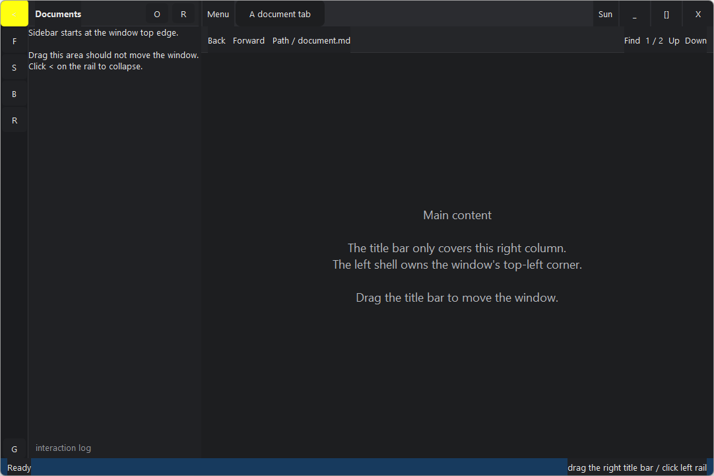
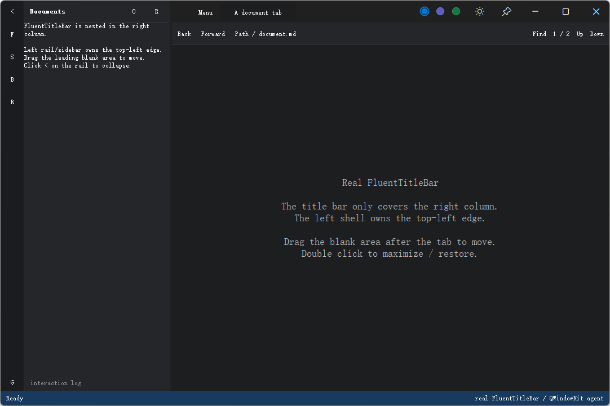
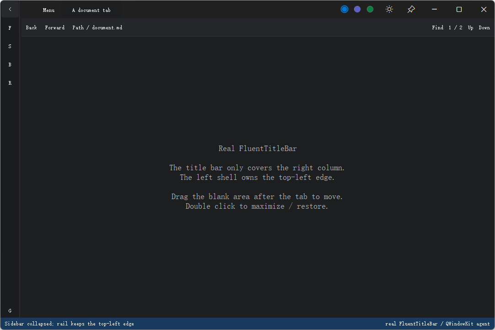
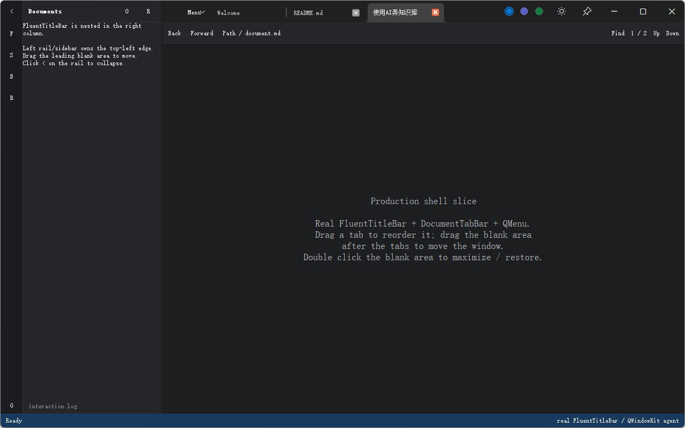
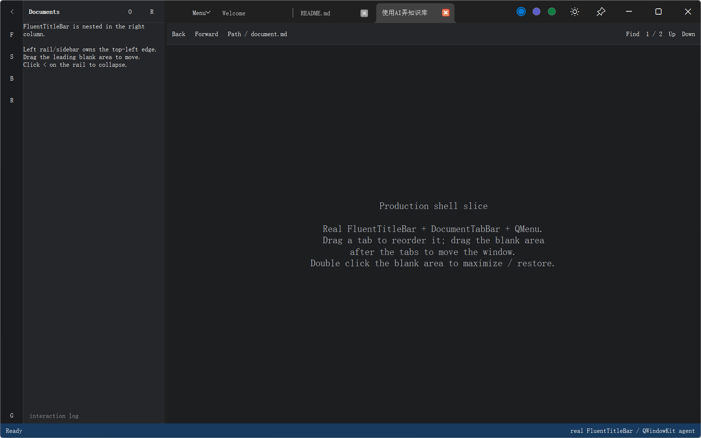
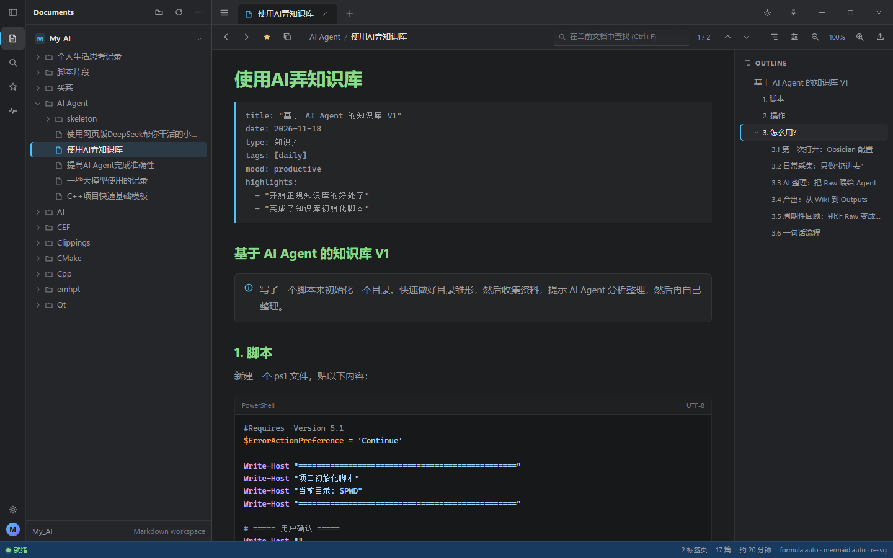

# Shell / QWindowKit demos

这些 Demo 用来验证「左侧活动栏 + 侧栏直达窗口顶部、标题栏只覆盖右侧主区」
这一套编辑器式外壳，以及它和 QWindowKit、FluentUI、真实标签栏之间的冲突。
它们不参与发布，也不进入安装包。

## 构建

Demo 依赖 `qt_md_viewer` 已经构建出的 `Frameless`、`FluentUI3Style` 和
QWindowKit 目标，因此必须和 viewer 一起打开：

```bat
cmake -S . -B build\qt5_15_2-x86 -G Ninja ^
  -DCMAKE_BUILD_TYPE=RelWithDebInfo ^
  -DCMAKE_PREFIX_PATH=D:\Qt22\5.15.2\msvc2019 ^
  -DQLITEMD_QT_MAJOR=5 ^
  -DQLITEMD_BUILD_QT_MD_VIEWER=ON ^
  -DQLITEMD_BUILD_SHELL_DEMOS=ON
cmake --build build\qt5_15_2-x86 ^
  --target shell_demo_qwk_nested_titlebar shell_demo_fluent_titlebar shell_demo_production
```

Windows 本地也可以先 `build.bat` 初始化出构建目录，再用上面的 `cmake -D...` 打开
`QLITEMD_BUILD_SHELL_DEMOS`；选项默认是 OFF，已有构建目录需要显式覆盖缓存。

运行前按本仓规则设置 Qt 和构建输出目录：

```bat
set "PATH=D:\Qt22\5.15.2\msvc2019\bin;D:\trae_workspace\qlitemd\build\qt5_15_2-x86\bin;%PATH%"
set "QT_PLUGIN_PATH=D:\Qt22\5.15.2\msvc2019\plugins"
build\qt5_15_2-x86\bin\shell_demo_production.exe
```

## Demo 清单

### `qwk_nested_titlebar`

最小 QWindowKit 验证：普通 QWidget 标题栏只放在右列，左侧活动栏 + 侧栏
从窗口最上沿开始。

验证点：

- `setTitleBar()` 支持不是从 `(0,0)` 开始、也不是 `menuWidget` 的标题栏；
- 右侧标题栏拖动移动窗口；
- 左侧栏顶部拖动不会移动窗口；
- 标题栏内按钮需要 `setHitTestVisible()` 才能收到物理点击；
- 系统按钮通过 `setSystemButton()` 注册。



### `fluent_titlebar`

用真实 `FluentTitleBar` 替换普通标题栏，并加载真实 `FluentUI3Style`。

验证点：

- `FluentTitleBar` 可以被 reparent 到右列；
- 菜单、主题、置顶、最小化/最大化/关闭按钮的命中正常；
- `setLeadingWidget()` + stretch factor 让标签区吃满剩余宽度；
- leading 空白区需要自己的 `WindowDragArea::startSystemMove()`；
- 侧栏收起和 splitter 拖动时，标题栏左边界跟随移动；
- 原生边缘缩放、最大化/还原正常。



收起侧栏：



### `production_shell_slice`

生产外壳切片：真实 `FluentTitleBar` + 真实 `DocumentTabBar` + 真实 `QMenu`，
左侧仍使用假数据侧栏。

验证点：

- 标签栏的点击和拖动重排不会被窗口拖动抢走；
- 标签栏空白区仍能拖动窗口；
- 真实 `QMenu` 能从标题栏按钮弹出；
- 八方向原生缩放，包括被左侧栏覆盖的上边缘和左上角；
- 最大化/还原；
- 100% 与 150% DPI 下标签、标题栏、侧栏边界和菜单命中正常。



150% DPI：



## 已验证的结论

- QWindowKit 支持右侧列标题栏；标题栏不需要是全宽 `menuWidget`。
- 左侧活动栏/侧栏可以占住窗口左上角，原生缩放仍然优先命中窗口边缘。
- `FluentTitleBar` 必须配合 `FluentUI3Style`；普通 QSS 下 caption 按钮会显示异常。
- 真实 `DocumentTabBar` 的标签高度是 38px，leading 顶部留 4px，所以标题栏高度
  应取 42px，否则标签会被裁切。
- 标签数量多时会把标题栏剩余空间吃光，必须给拖动区留最小宽度（本 Demo 为 96px），
  否则窗口没有可拖动区域。
- 标题栏内的交互控件都要登记 `setHitTestVisible()`；系统按钮还要
  `setSystemButton()`。

## 仍未验证

- Win11 Snap Layouts 悬停面板；
- `Alt+Space` 系统菜单；
- Mica / Acrylic / DWM blur 与这套左右外壳的叠色；
- 多显示器、跨 DPI 拖动；
- 正式程序里 `FluentWindowFrame` 的自定义 chrome 宿主方案；
- 多窗口（主窗口 + 次窗口）同时使用这套外壳。

## HTML 布局原型

`shell_layout_prototype.html` 是纯静态交互原型，可切换明暗、收起侧栏、拖动侧栏宽度：

- `?theme=light`
- `?collapsed=1`


