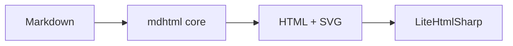

# qlitemd core on Avalonia

This page is rendered by the zero-Qt `qlitemd_mdhtml` core and displayed by
`LiteHtmlSharp.Avalonia`. The C# host only marshals HTML, SVG assets and
code blocks across the C ABI.

> [!note] MPE callout mode
> Inline text after the marker is the title; the body starts on the next line.

> [!tip] GitHub admonitions remain available
> Set `admonition_mode` to `MDHTML_ADMONITION_GITHUB` for md4c's built-in
> five-type admonitions.

Inline math: $e^{i\pi} + 1 = 0$

$$
\int_{-\infty}^{\infty} e^{-x^2}\,dx = \sqrt{\pi}
$$



```cpp
// Highlighting and copy links come from the core.
int main() {
  return 0;
}
```

| Layer | Technology |
| --- | --- |
| Parser | md4c |
| Highlight | tree-sitter |
| Formula | RaTeX |
| Mermaid | mermaid.js (QuickJS) |

[qlitemd repository](https://github.com/)
